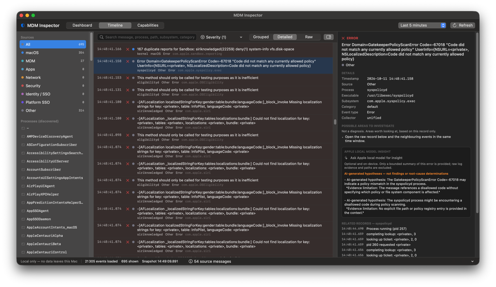

# MDM Inspector


[](LICENSE)

MDM Inspector brings macOS and MDM logs into one timestamped timeline, with the original record one click away. For a selected error, you can optionally ask Apple's on-device model for troubleshooting ideas. Results are **AI-generated hypotheses—not findings or root-cause determinations**; an administrator must verify them.



*Example only: model suggestions are hypotheses and may be incorrect. Check the original evidence before acting.*

The app reads local Mac evidence only: no MDM-server queries, cloud backend, telemetry, or database.

## MDM coverage

Dedicated local log sources cover **Apple MDM, Microsoft Intune, Omnissa Workspace ONE (Intelligent Hub), Jamf Pro, Kandji, ManageEngine, and N-able**. Unified-log/process classification also recognizes **Addigy, Cognito, Hexnode, Meraki, Mosyle, Scalefusion, and SimpleMDM** when their records are present. Coverage is read-only; MDM Inspector does not configure devices or replace an MDM console.

Other local context includes Platform SSO, running processes, macOS install/update/security logs, Microsoft Defender for Endpoint, and selected app/network logs.

## Optional Apple local-model insight

Select an error-level Timeline event, then click **Ask Apple local model for insight** in the Inspector. It requires:

- macOS 27 or later and Apple's on-device model available.
- Apple Foundation Models terms accepted. If needed, run `fm license` in Terminal to review and accept them. The app checks with read-only `fm license --status`; it never accepts terms for you.

The bounded prompt includes a short summary of the selected event, but excludes the raw record, executable path, and neighboring events. The event message may still contain sensitive text. Suggestions are limited to safe, reversible checks; verify them independently.

## Download

**[Download the latest Apple Silicon app](https://github.com/superjaegermaster/MDMInspector/releases/latest/download/MDM-Inspector.app.zip)** or see [all releases](https://github.com/superjaegermaster/MDMInspector/releases). Current release: **v0.1.1** (app version **0.1**, build **8**). The app is ad-hoc signed and not notarized; on first launch, Control-click it, choose **Open**, and confirm. The included PKG is unsigned.

## Build and test

Requires macOS 14+ and Swift 6. Apple local-model insights require macOS 27+.

```zsh
swift build -c release
swift run -c release MDMInspectorSelfTest
./build_app.sh --version 0.1 --build 8
open "build/MDM Inspector.app"
```

To package installers, run `./make_installer.sh --version 0.1 --build 8`.
`CFBundleShortVersionString` is the marketing version; `CFBundleVersion` is the numeric build number.

## Limits and more detail

MDM Inspector shows local evidence, not server-side actions or a confirmed cause. It does not correlate incidents automatically, detect loops, or manage devices. Unified-log access requires Full Disk Access; other sources report when unavailable.

See the concise [interface guide](docs/INTERFACE.md), [contributing guide](CONTRIBUTING.md), or [license](LICENSE).
